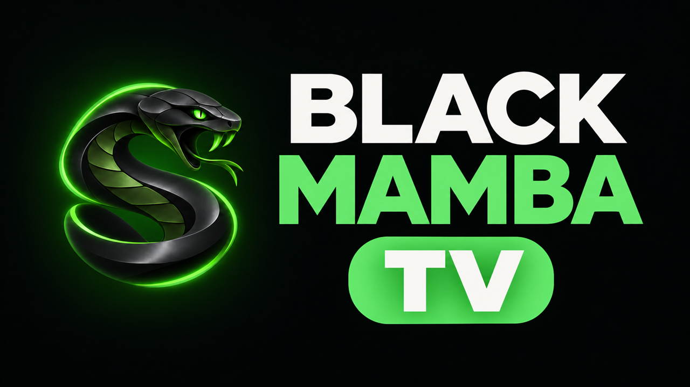

# Black Mamba TV



Signed builds of Black Mamba TV, the family media app for Fire TV and Android TV. It's a
private build of the [Wholphin](https://github.com/damontecres/Wholphin) Jellyfin client
with Tailscale built in, so it reaches the home media server from anywhere. It also sets the
server up by itself and gives Anime its own section.

Installed copies of Black Mamba TV update themselves from this repository's releases. The
source is kept in a separate private repository, and every release includes the matching
source archive.

## Install on a Fire TV

1. On the Fire TV, open **Find → Search**, then search for and install **Downloader** (by
   AFTVnews).
2. Go to **Settings → My Fire TV → Developer options → Install unknown apps** and turn
   **Downloader** on. If Developer options is missing, open **Settings → My Fire TV →
   About** and click the device name 7 times.
3. Open Downloader and enter this address:

   ```
   https://github.com/DevJonasPereira/black-mamba-tv-releases/releases/latest/download/BlackMamba-release.apk
   ```

   Then choose **Install**.
4. Open **Black Mamba TV**. If it can't reach the server directly, it shows a QR code. Scan the
   code with a phone and sign in to Tailscale. This only needs doing once.
5. Pick your Jellyfin user and sign in.

On other Android TVs, sideload the same APK the way you normally would.

## Updates

Black Mamba TV checks this repository when it starts and shows a message when a new version is
out. To install it, go to **Settings → Check for updates**. The first time, the TV asks you
to allow Black Mamba TV to install unknown apps. Turn it on and go back.

Android only installs an update when it's signed with the same key as the installed app.

## Files in each release

| File | What it is |
|---|---|
| `BlackMamba-release.apk` | Works on every TV (use this one if unsure) |
| `BlackMamba-release-armeabi-v7a.apk` | Smaller build for 32-bit TVs (most Fire TV Sticks) |
| `BlackMamba-release-arm64-v8a.apk` | Smaller build for 64-bit TVs |
| `BlackMamba-release-x86_64.apk` | For emulators |
| `SHA256SUMS` | Checksums of the files above |
| `black-mamba-source-*.tar.gz` | Source code of that release (GPL-2.0) |

## Checking a download

Every APK is signed with the Black Mamba TV key. Its certificate SHA-256 is:

```
53:42:37:E1:61:B8:47:96:AE:F0:75:0A:89:9A:4C:C8:CA:12:84:48:6D:94:4B:19:39:92:3A:7B:AC:99:65:A2
```

To check a file with the Android SDK build tools:

```sh
apksigner verify --print-certs BlackMamba-release.apk
sha256sum -c SHA256SUMS
```

## License

Black Mamba TV is based on Wholphin, which is GPL-2.0, and is distributed under the same
license. The source for each version is attached to its release. Tailscale's code is
BSD-3-Clause.
